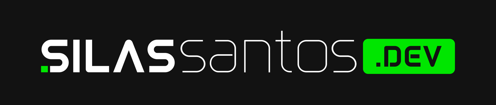

  

  <b>Senior Back-End / Full Stack Developer</b> building payment systems, APIs and microservices with Node.js, NestJS, TypeScript and React. 
  Brazil · Remote · Open to new opportunities

---

### Tech Stack

**Languages & Frameworks** 

**Databases & ORMs** 

**Architecture & Messaging** 

 
Microservices · Clean Architecture · CQRS · BFF · REST · WebSockets · Serverless

**Cloud & DevOps** 

**Testing** 

**Observability & Load Testing** 

---

### Experience Highlights

Building back-end systems professionally since 2021.

- **Payments** – Multi-tenant payments platform (Pix, withdrawals, deposits, cards), with Pix settlement providers (SPB/DICT), MED flows, webhooks and asynchronous event processing. Helped expand the platform to Mexico (SPEI).
- **Architecture** – Monolith-to-microservices migrations, CQRS to speed up listings and dashboards, serverless microservices on AWS and BFFs with NestJS and Clean Architecture.
- **Integrations** – Integrations with financial institutions (Fiserv, FIS, Matera) and payment gateways (Asaas, Pagar.me, Iugu), focused on availability and data consistency.
- **Java** – Mobile app API built with Java 21 and Spring Boot 3 (Spring Security with JWT, JPA, PostgreSQL and Flyway), with push notifications, SMS and email, and PDF certificates.
- **Production** – Front line on production incidents (ingestion bottlenecks, connection deadlocks, DLQ reprocessing) and post-incident action plans.
- **Data** – Processing of large volumes of files and data, and a database migration from RethinkDB to PostgreSQL.
- **Leadership** – Tech lead for small teams: sprints, estimates, code review and mentoring junior developers.

---

### Featured Projects

| Project | What it does | Stack |
| --- | --- | --- |
| [users-import-devops-k8s](https://github.com/silasoli/users-import-devops-k8s) | Users API with asynchronous imports via RabbitMQ, Redis cache and idempotency, Kubernetes deployment, Prometheus/Grafana observability and k6 stress tests | NestJS · RabbitMQ · MongoDB · Redis · Kubernetes · GitHub Actions |
| [opencommerce-api](https://github.com/silasoli/opencommerce-api) | E-commerce API with orders, products and integrations with Asaas (payments), Nuvemshop, Melhor Envio and ViaCEP | NestJS · PostgreSQL · TypeORM · Docker · GitHub Actions |
| [your-lib-api](https://github.com/silasoli/your-lib-api) | Personal library manager: books, loans, waitlists with email notifications | NestJS · MongoDB · Docker · GitHub Actions |
| [easy-budget-api](https://github.com/silasoli/easy-budget-api) | MVP that standardizes budget creation for the construction industry | NestJS · MongoDB · JWT · Swagger |

---

### GitHub Stats

  
  

---

### Contact

